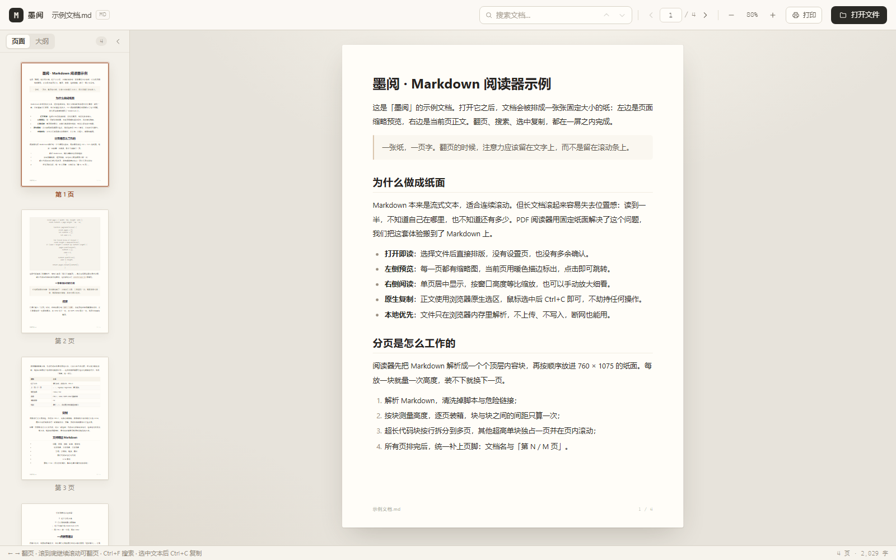
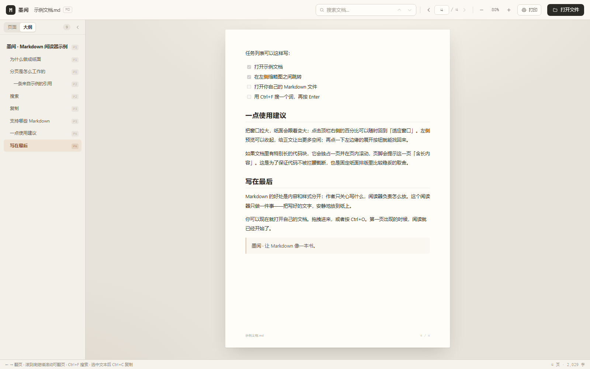
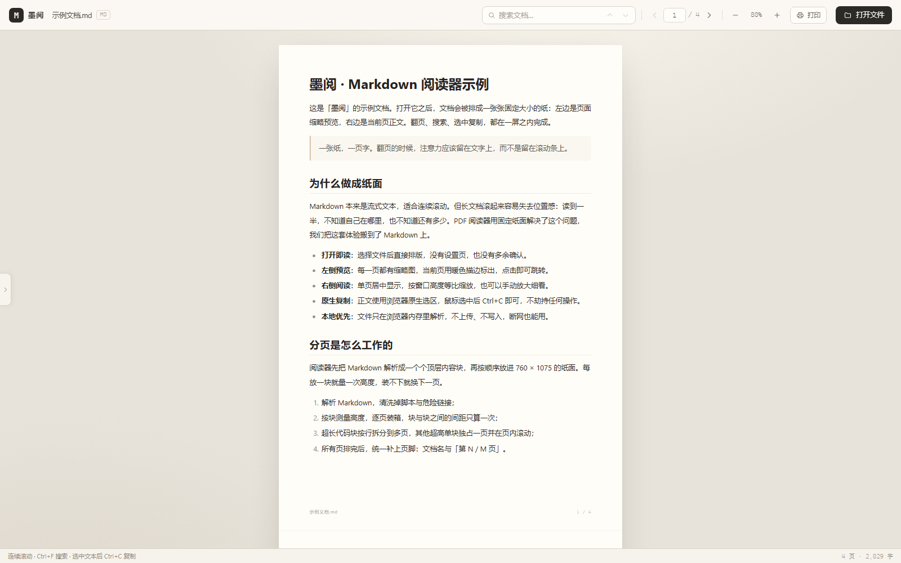
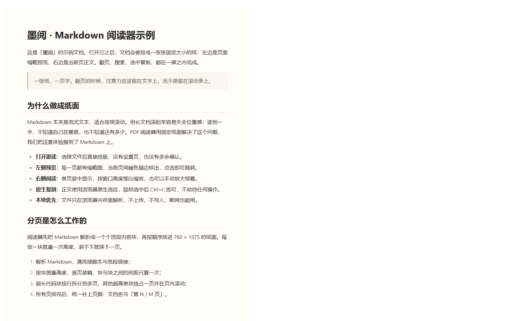

# 墨阅 · Markdown 阅读器

一个零依赖、零安装的 Markdown 文档阅读器：打开文件即进入阅读状态，按 PDF 的方式**左侧页面预览、右侧单页阅读**，支持**文档大纲**、**连续滚动**、全文搜索与原生选中复制。

> GitHub：[bundur163/moyue](https://github.com/bundur163/moyue) · 项目中文名《墨阅》



## 快速开始

任选一种，双击即可：

- **单文件版**：`Markdown阅读器.html`（约 135 KB，已内联全部样式、脚本与示例文档）；
- **源码版**：`index.html`（需要同目录的 `assets/` 与 `vendor/`）。

打开后：

1. 点击「打开文件」或「选择文件」，也可以把 `.md` 文件直接拖进窗口；
2. 文档自动分页，进入阅读状态，无需任何设置；
3. 左侧「页面」显示缩略图，「大纲」显示标题目录，点击均可跳页；
4. 收起左栏进入**连续纸面**模式，所有页按页尾接页首拼接，滚动条连续滚动。

无需后端、无需联网；文档只在浏览器内存中解析，不会上传或写入本地存储。

| 大纲模式 | 连续滚动 |
| --- | --- |
|  |  |

打印预览（A4 逐页输出，工具栏与搜索高亮不进入打印稿）：



## 功能

- **打开即读**：`.md` / `.markdown` / `.txt`，自动识别 UTF-8、UTF-16、GB18030；
- **PDF 式纸面**：760 × 1075 的固定纸张，自动分页、页脚页码、适应窗口缩放；
- **页面 / 大纲双模式**：缩略图预览与文档标题目录一键切换；点击大纲项跳到对应页并高亮当前项；
- **连续纸面**：收起预览或大纲后，页面页尾接页首拼成长纸，滚动条连续滚动，页码随滚动同步；
- **滚轮翻页**：单页模式滚到底后继续下滚自动到下一页；顶部继续上滚回到上一页；
- **全文搜索**：命中计数、跨页跳转、搜索高亮；连续模式高亮全部页面；
- **打印**：顶栏打印按钮或 Ctrl+P，按逐页 A4 打印全文，自动隐藏应用界面，溢出页延展不裁切；
- **选中复制**：正文使用浏览器原生选区，Ctrl+C / 右键复制，阅读器不劫持鼠标；
- **键盘操作**：← →、PageUp / PageDown、Home / End、Ctrl+F、Ctrl+O；
- **安全清洗**：移除脚本、事件属性与 `javascript:` 链接；
- **超长内容**：超长代码块按行拆分到多页，其他超高单块在页内滚动。

## 操作一览

| 操作 | 方式 |
| --- | --- |
| 打开文件 | 顶栏「打开文件」、空状态按钮、拖拽文件、Ctrl+O |
| 切换页面 / 大纲 | 侧栏顶部「页面」「大纲」标签 |
| 点击大纲跳页 | 大纲项右侧显示 `P<页码>`，点击定位 |
| 上一页 / 下一页 | ← →、PageUp / PageDown、顶栏箭头 |
| 连续滚动翻页 | 向下滚动阅读区；滚到底自动衔接下一页 |
| 单页滚轮翻页 | 页底再下滚 → 下一页；页顶再上滚 → 上一页 |
| 首页 / 末页 | Home / End |
| 跳页 | 在页码框输入页码后回车 |
| 搜索 | Ctrl+F，输入关键词；Enter 下一个，Shift+Enter 上一个 |
| 清除搜索 | Esc 或搜索框右侧 × |
| 缩放 | 顶栏 − / +；点击百分比恢复「适应窗口」 |
| 打印 | 顶栏「打印」或 Ctrl+P；打印全文，每个逻辑页一张 A4 |
| 收起 / 展开侧栏 | 侧栏右上角 ⟨、阅读区左边缘 ⟩；收起即进入连续纸面 |

## 支持哪些 Markdown

- CommonMark 基础语法与 GFM 扩展：标题、段落、强调、删除线、链接、图片；
- 有序 / 无序 / 任务列表，引用，分隔线；
- 围栏代码块与行内代码；
- GFM 表格（表格可横向滚动）；
- 原始 HTML（经安全清洗）。

## 文件结构

```
mdviewer/
├─ index.html                    源码版入口（双击运行）
├─ Markdown阅读器.html           单文件版（由 build_single.py 生成）
├─ assets/
│  ├─ styles.css                 全部样式
│  └─ app.js                     解析、分页、搜索、交互
├─ vendor/
│  ├─ marked.min.js              marked v15.0.12（MIT）
│  └─ marked.LICENSE
├─ build_single.py               生成单文件版
├─ .gitignore                    发布时排除无关本地文档
├─ 工作规则.md
├─ 设计/Markdown 阅读器设计说明书 V1.2.md
├─ 日志/2026-11-24.md
└─ 测试/
   ├─ fixtures/                  验收文档、长代码块、GB18030 文档
   ├─ test_reader.mjs            Edge headless + CDP 自动化测试
   ├─ 测试记录.md
   └─ 截图/
```

## 实现要点

- **分页**：把 Markdown 解析成顶层块，逐块测量高度装入纸张；装不下就换页；超长代码块按行拆分，其他超高单块标记为页内滚动。
- **大纲**：扫描每页 `h1–h6`，按标题层级与页码生成侧栏目录；点击跳页并把标题滚入可视区。
- **连续布局**：收起侧栏后，所有页放入同一个长纸容器，页尾接页首；滚动时以页面中心判定当前页，同步页码与大纲。
- **滚轮翻页**：单页模式优先滚页内内容、再滚阅读区，到边界后累计滚轮距离翻页；800ms 冷却防止触控板连续跳页。
- **搜索**：遍历每页文本节点做子串匹配，使用 CSS Custom Highlight API 高亮（不修改 DOM，因此不影响选区与复制）；单页模式只标当前页，连续模式标全部页面；命中上限 5000 条。
- **复制**：正文设置 `user-select:text`，不监听或阻止鼠标/复制事件；高亮与页脚不进入选区。
- **缩放**：只改变 `transform: scale()`，不重新分页；`ResizeObserver` 在「适应窗口」模式下自动重算；连续布局会同步重排每一页。
- **单文件打包**：`build_single.py` 将 CSS、marked、app.js 与许可证内联，产出可直接分发的 HTML。
- **打印**：把全部逻辑页克隆进隐藏的 `.print-root`，用 `@media print` 切换为 A4 纸张；每页一张纸，工具栏/侧栏/搜索高亮不进入打印稿。

## 测试

```powershell
# 重新生成单文件版
python build_single.py

# 自动化验收（需要 Microsoft Edge；可用 EDGE_PATH 指定路径）
node 测试/test_reader.mjs
```

最近一次结果：**87 / 87 通过**，覆盖空状态、分页、缩略图、搜索、高亮、复制、翻页、缩放、侧栏、真实文件选择、GB18030、超长代码块拆分、超高块兜底、安全清洗、空白文档、单文件版、文档大纲、连续滚动、滚轮翻页与打印版式。详见 [`测试/测试记录.md`](测试/测试记录.md)。

## 已知限制

- 搜索按文本节点匹配，跨加粗/链接等内联标签拆开的词组可能搜不到；
- 相对路径图片在 `file://` 下无法加载，请使用网络图片或 data URI；
- 搜索高亮依赖 Chrome / Edge 的 CSS Custom Highlight API（105+）；其他浏览器仍可计数与跳页，但没有高亮；
- 超长表格或超长单段会独占一页并在页内滚动，页脚状态栏会提示「含长内容」；
- 大纲只列 `h1–h6`，不做多级折叠目录树；图片/表格/代码块内的标题不会成为独立目录项；
- 连续纸面会把所有页面同时挂载，超大文档（数百页）建议使用单页模式；页脚页码在连续滚动中仍会重复出现；
- 单页滚轮翻页有 800ms 冷却，触控板快速惯性滚动可能只翻一页；
- 打印依赖浏览器打印对话框；建议选择 A4、关闭浏览器页眉页脚，并在打印预览确认背景图形；
- 不保存阅读进度，不做批注与编辑。

## 项目文档

- [设计说明书 V1.2](<设计/Markdown 阅读器设计说明书 V1.2.md>)：需求、分页、大纲、连续纸面、滚轮翻页、打印与测试方案
- [工作日志](日志/2026-11-24.md)：指令登记、执行过程、成果与变更影响评估
- [测试记录](测试/测试记录.md)：87 项自动化验收与截图索引
- [工作规则](工作规则.md)：本项目的目录、日志与交付规范

## 许可证

- 本项目代码可自由使用与修改；
- Markdown 解析使用 [marked](https://github.com/markedjs/marked) v15.0.12，MIT License，许可证全文见 `vendor/marked.LICENSE`，单文件版末尾亦以内联注释保留。
